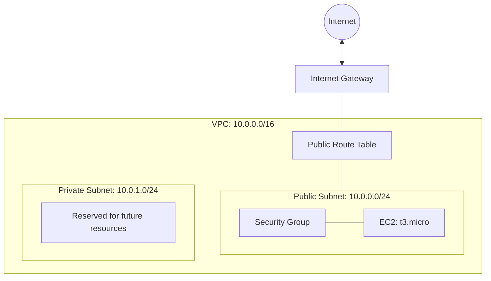

# AWS VPC with Terraform

A beginner-friendly Infrastructure as Code (IaC) project created to learn AWS networking and EC2 provisioning with Terraform.

## Project Overview

This project provisions a basic AWS environment in the `sa-east-1` (São Paulo) region.

## Architecture



## AWS Resources

- VPC with CIDR block `10.0.0.0/16`
- Public subnet: `10.0.0.0/24`
- Private subnet: `10.0.1.0/24`
- Internet Gateway
- Public route table and subnet association
- Security group restricting SSH access to a configured IP
- EC2 key pair registration
- Amazon Linux 2023 EC2 instance (`t3.micro`)
- Terraform outputs for the public IP and SSH command

## Design Decisions

- **VPC CIDR:** A `/16` network provides room for future subnets and expansion.
- **Public subnet:** Hosts the EC2 instance and uses an Internet Gateway for internet routing.
- **Private subnet:** Created as a foundation for future resources. It currently has no dedicated route table or workloads.
- **SSH security:** Port 22 is restricted to the CIDR configured through the `meu_ip` variable.
- **Infrastructure as Code:** Terraform makes infrastructure changes repeatable and easier to review.

## Prerequisites

- Terraform installed
- AWS CLI configured with authorized credentials
- An SSH key pair available locally
- Appropriate AWS IAM permissions

## How to Use

### 1. Clone the repository

```bash
git clone <YOUR_REPOSITORY_URL>
cd terraform-aws-primeira-vpc
```

### 2. Initialize Terraform

```bash
terraform init
```

### 3. Configure your IP address

Copy `terraform.tfvars.example` to `terraform.tfvars` and replace the example IP with your current public IP in `/32` format.

### 4. Review the execution plan

```bash
terraform plan
```

### 5. Deploy the infrastructure

```bash
terraform apply
```

Review the proposed changes and confirm before provisioning resources.

## Cleanup

When you finish experimenting, run:

```bash
terraform destroy
```

Review the destruction plan before confirming. This removes resources managed by this Terraform configuration.

## Cost and Security Notice

This project is for educational purposes and is not intended for production use.

AWS resources may incur charges. Check current pricing and remove unused resources.

Never commit AWS credentials, private SSH keys, Terraform state files, or real local variable files.

## Future Improvements

- Configure a dedicated route table for the private subnet.
- Explore NAT Gateway connectivity when required.
- Use AWS Systems Manager Session Manager instead of direct SSH access.
- Add input validation and reusable Terraform modules.
- Automate formatting and validation with a CI workflow.
